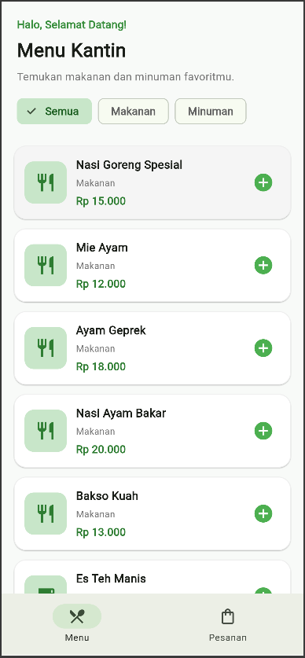
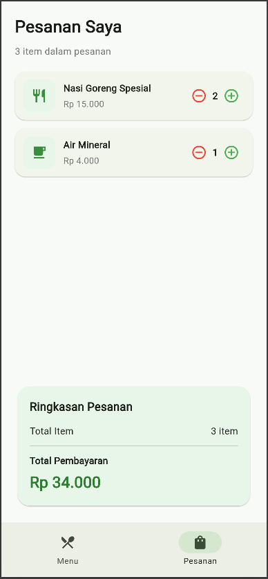
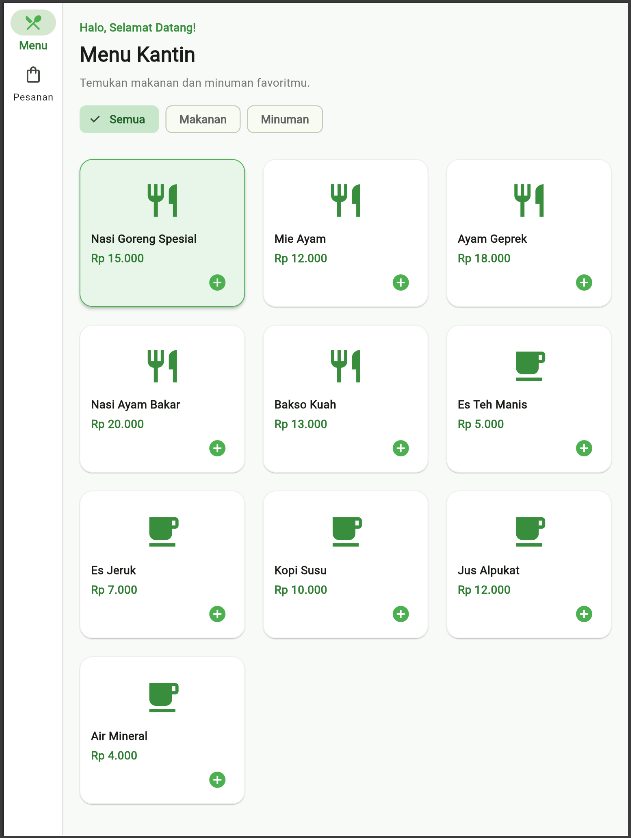
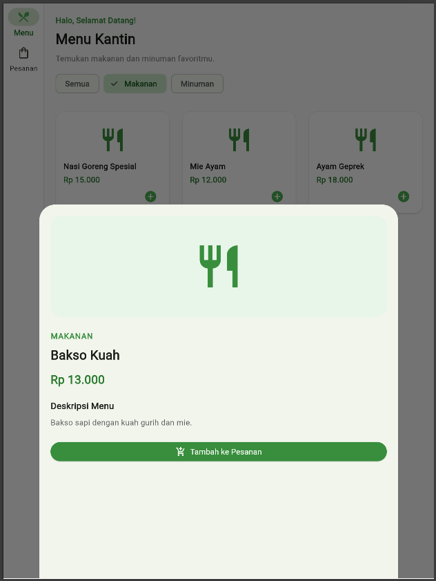
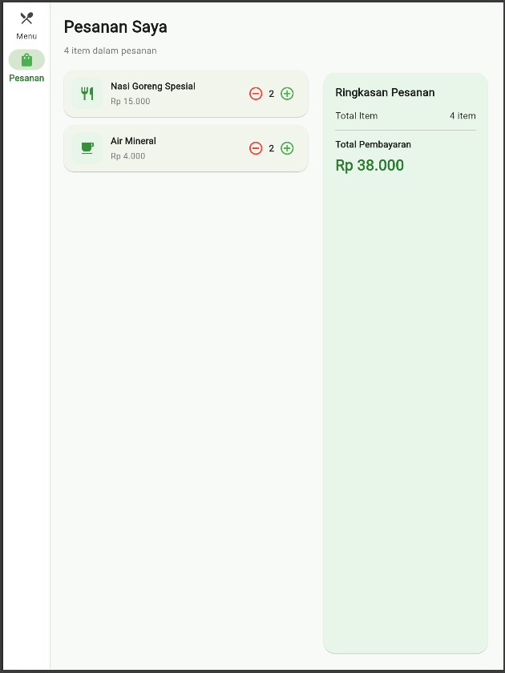

# NusaKantin

**Aplikasi Menu dan Pemesanan Kantin Kampus Berbasis Flutter**

## Deskripsi

NusaKantin merupakan aplikasi sederhana berbasis Flutter yang dirancang untuk menampilkan daftar makanan dan minuman kantin kampus serta mengelola pesanan pengguna.

Aplikasi ini menerapkan Responsive Design sehingga tampilan dapat menyesuaikan ukuran layar HP, tablet, maupun desktop.

## Fitur Aplikasi

- Menampilkan daftar menu makanan dan minuman.
- Filter menu berdasarkan kategori.
- Melihat detail menu.
- Menambahkan menu ke pesanan.
- Mengatur jumlah pesanan.
- Menghitung total harga secara otomatis.
- Navigasi responsif menggunakan NavigationBar dan NavigationRail.
- Mendukung tampilan portrait dan landscape.

## Teknologi

- Flutter
- Dart
- Material Design 3
- ChangeNotifier

## Responsive Design

Aplikasi menggunakan tiga kategori ukuran layar:

| Kategori | Lebar |
|---|---|
| Compact | Di bawah 600 px |
| Medium | 600–839 px |
| Expanded | 840 px ke atas |

Penyesuaian tampilan:
- HP: NavigationBar dan ListView.
- Tablet medium: NavigationRail dan GridView.
- Tablet expanded: NavigationRail, GridView, dan panel detail menu.

## Struktur Folder

```text
lib/
├── main.dart
├── domain/
│   └── models/
│       └── menu_item.dart
├── data/
│   └── repositories/
│       └── menu_repository.dart
└── ui/
    ├── core/
    │   └── window_size.dart
    ├── menu/
    │   ├── menu_view_model.dart
    │   ├── menu_screen.dart
    │   └── widgets/
    │       ├── menu_list.dart
    │       ├── menu_grid.dart
    │       └── menu_detail.dart
    └── pesanan/
        └── pesanan_screen.dart

test/
└── widget/
    └── responsive_layout_test.dart
```

## Cara Menjalankan Aplikasi

1. Clone repository.
2. Masuk ke folder project.
3. Jalankan `flutter pub get`.
4. Jalankan `flutter run -d chrome`.

## Pengujian

Pengujian dilakukan menggunakan Flutter Widget Test untuk memeriksa:
- Layout HP.
- Layout tablet medium.
- Layout tablet expanded.
- Tampilan landscape.
- Pembesaran teks 200%.

Jalankan pengujian dengan perintah:

```bash
flutter test
```

## Dokumentasi Screenshot

### Tampilan HP
Tambahkan screenshot aplikasi pada ukuran HP.

### Tampilan Tablet
Tambahkan screenshot aplikasi pada ukuran tablet.

### Tampilan Menu
Tambahkan screenshot halaman menu dan detail menu.

### Tampilan Pesanan
Tambahkan screenshot halaman pesanan.

---

**Project Tugas Pemrograman Perangkat Mobile**  
**NusaKantin – Flutter Responsive Application**


## Dokumentasi Screenshot

### Tampilan HP

**Halaman Menu**



**Halaman Pesanan**



### Tampilan Tablet

**Halaman Menu**



**Detail Menu**



**Halaman Pesanan**


