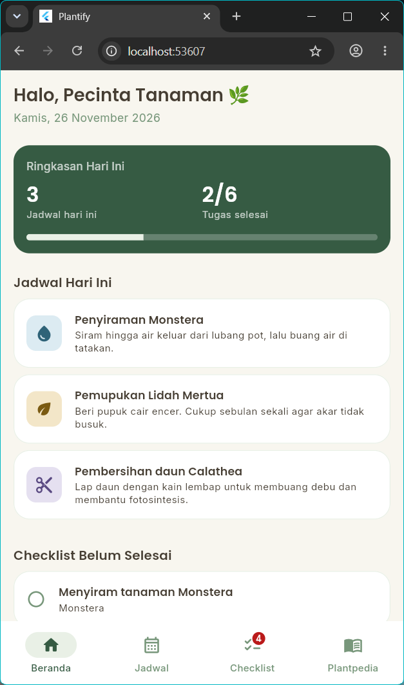
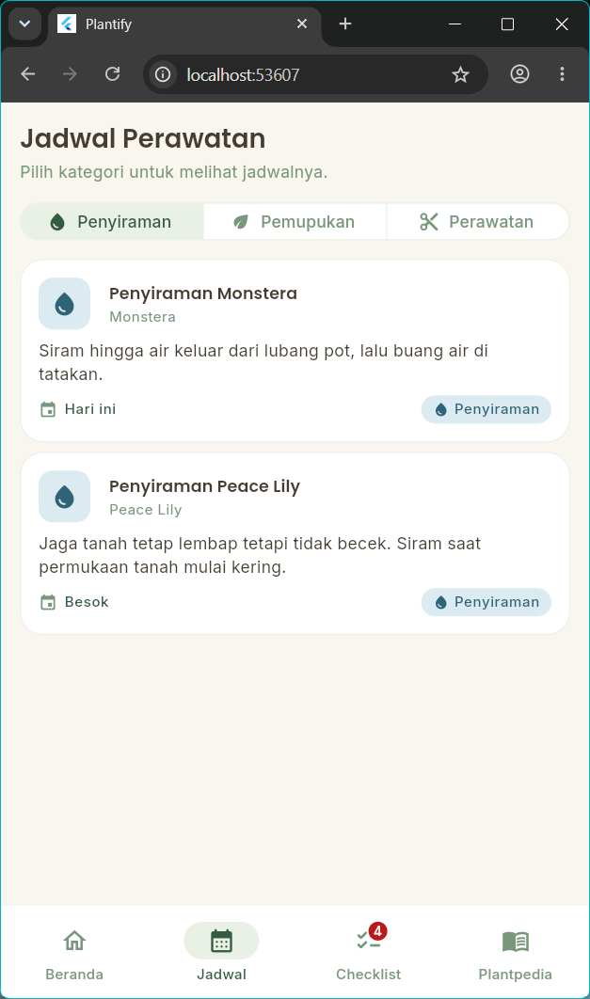
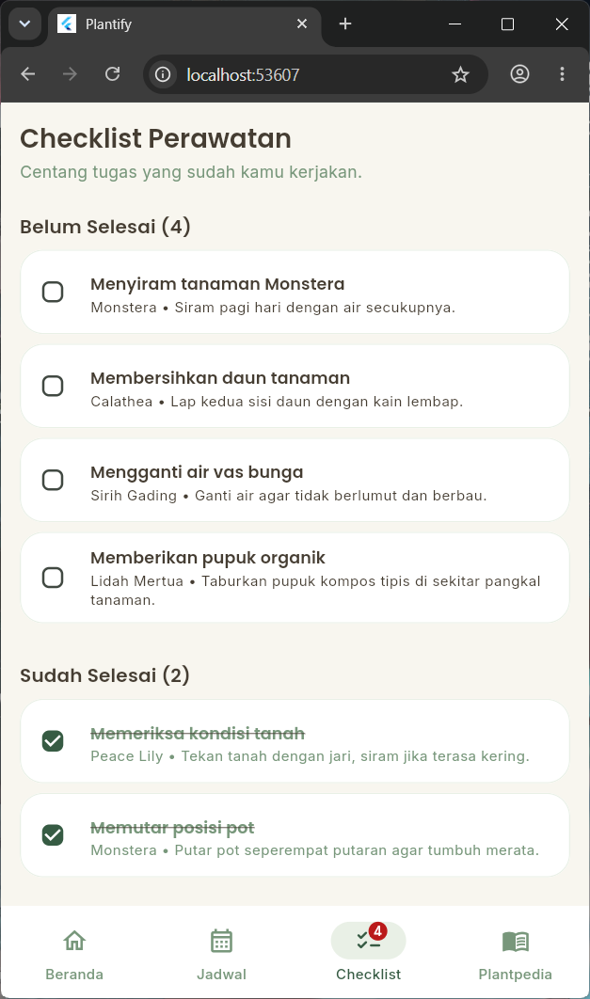
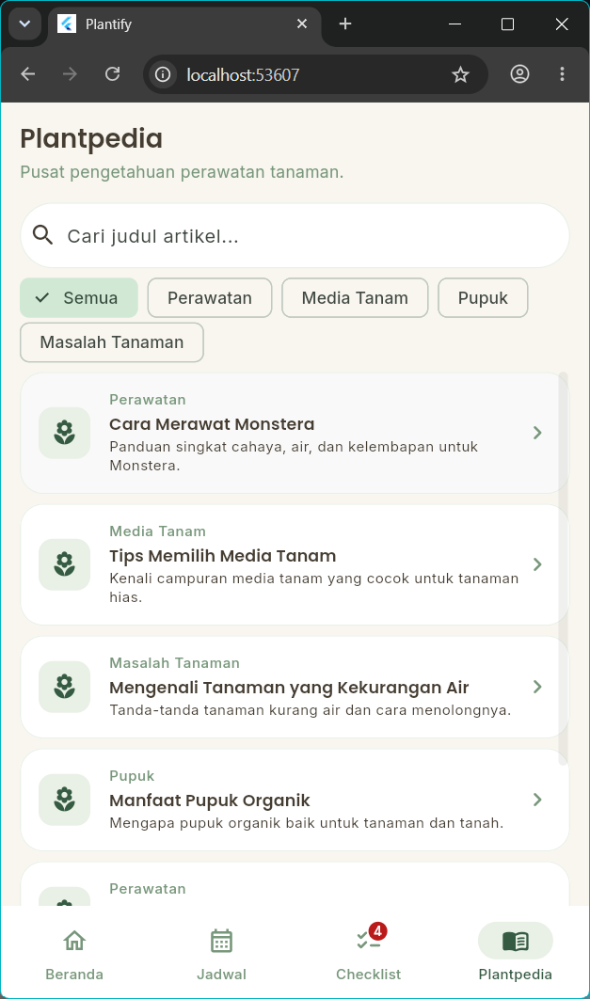

# Plantify

**Your Smart Plant Care Companion**

Aplikasi Flutter untuk mengelola perawatan tanaman: jadwal penyiraman dan pemupukan, checklist aktivitas, dan pusat informasi tanaman. Dibuat untuk tugas mata kuliah Pemrograman Perangkat Mobile dengan arsitektur berlapis (View, ViewModel, Repository, Service).

## Tema dan Alasan Memilih

Tema yang dipilih adalah **perawatan tanaman hias**. Banyak pemilik tanaman, terutama pemula, sering lupa jadwal menyiram dan memupuk, serta bingung mencari informasi perawatan yang mudah dipahami. Tema ini cocok karena secara alami memiliki jadwal per kategori, tugas yang bisa dicentang, dan artikel informasi.

## Pemetaan Model Data

| Jenis data | Model | Penjelasan | Dipakai di |
|---|---|---|---|
| Data utama | `PlantSchedule` | Jadwal perawatan dengan tanggal dan kategori (Penyiraman, Pemupukan, Perawatan) | Beranda, Jadwal |
| Data aksi | `PlantTask` | Tugas perawatan yang bisa dicentang (punya `copyWith()`) | Beranda, Checklist, badge tab |
| Data informasi | `PlantInfo` | Artikel perawatan tanaman | Plantpedia |

## Fitur Buatan Sendiri: Plantpedia

Plantpedia adalah pusat pengetahuan perawatan tanaman. Pengguna dapat mencari artikel berdasarkan judul, menyaring berdasarkan kategori (Perawatan, Media Tanam, Pupuk, Masalah Tanaman), dan membuka halaman detail artikel. Fitur ini memiliki `PlantInfoRepository` sendiri, `PlantpediaViewModel`, dan unit test.

## Arsitektur

```
lib/
├── main.dart
├── app.dart
├── config/dependencies.dart      # MultiProvider
├── domain/models/                # PlantSchedule, PlantTask, PlantInfo
├── data/
│   ├── services/                 # PlantifyService (Future.delayed)
│   └── repositories/             # 3 repository (PlantTaskRepository = ChangeNotifier)
└── ui/
    ├── core/                     # tema dan widget bersama
    ├── shell/                    # AppShell + NavigationBar
    ├── home/ schedule/ checklist/ plantpedia/   # Screen + ViewModel
```

`PlantTaskRepository` adalah `ChangeNotifier` dan menjadi sumber data bersama, sehingga mencentang tugas di Checklist langsung memperbarui Beranda dan badge pada tab Checklist.

## Screenshot

### Setiap tab

| Beranda | Jadwal |
|---|---|
|  |  |

| Checklist | Plantpedia |
|---|---|
|  |  |

### Beranda sebelum dan sesudah item dicentang

| Sebelum (2/6) | Sesudah (3/6) |
|---|---|
|  |  |

## Hasil `flutter test`

```
00:10 +8: All tests passed!
```


## Cara Menjalankan

```bash
flutter pub get
flutter run -d chrome
flutter test
```